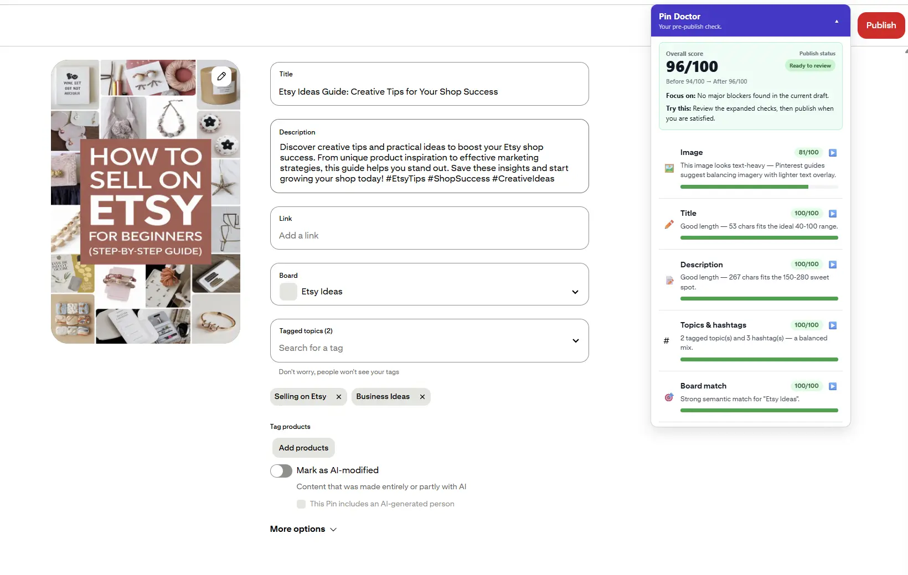
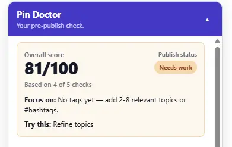
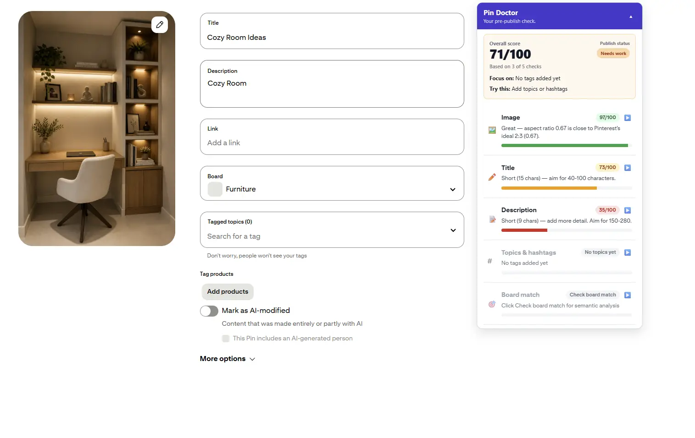
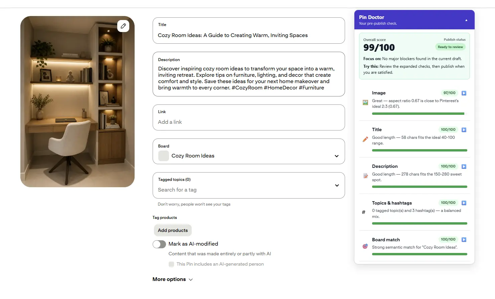

# Pinterest Pin Doctor: Fix the Weakest Part of a Pin Before Publishing

Most Pin checklists fail in the same way: they give you ten things to inspect and no clue where to start.

That’s not helpful when you’re preparing a batch of Etsy product Pins, writing a blog Pin between client calls, or trying to turn a POD design into a clear product post. You don’t need another dashboard full of warnings. You need to know which weakness is worth fixing first.

Pinello’s Pin Doctor is built for that moment. [Pinello](https://amrita-labs.com/pinello/?utm_source=amrita-labs&utm_medium=owned-content&utm_campaign=pinello_launch_2026-11&utm_content=pin-doctor-fix-weakest-part) is a free Chrome extension that scores Pinterest pins across 5 dimensions — image, board fit, title, description, and hashtags — in real time. Inside Create Pin, Pin Doctor shows the SEO Audit and uses **Focus next** to point to the most important unfinished part.

## What the Pin Doctor checks

Doctor looks at the pieces you can still change:

- The image and its available quality details
- The Pin title
- The description
- Topics and hashtags
- The selected board and board fit
- SEO-related fields available in the draft

Some checks are deterministic, such as whether a required field is blank or whether an image detail is available. Other guidance is Pinello’s own heuristic review. The interface uses source labels to make that difference visible:

- **From Pinterest**
- **Pinello check**
- **AI suggestion**
- **Not provided by Pinterest**

That’s a useful guardrail. A suggestion can help you rewrite a sentence, but it isn’t an official Pinterest instruction.

## Start with Focus next, not with every warning

Open the Doctor and look for the top issue. If the title is vague and the description is empty, don’t spend ten minutes choosing hashtags first. Fix the issue that makes the Pin hardest to understand.

Focus next can turn a broad review into one manageable action:

1. Read the issue.
2. Open the related field or repair action.
3. Edit the draft in Pinterest, or use a copy-only suggestion.
4. Return to the Doctor.
5. Check the before-and-after rescore.

You’re not trying to make the score perfect in one click. You’re making the next decision clearer.

## Example: an Etsy product Pin

Imagine a seller has a Pin for a handmade linen apron.

The image is attractive, but the title says “Kitchen Things.” The description says “Available now in my shop.” The topics include “home decor” and “summer style.” The selected board is “Recipe Inspiration,” which contains food photography but very few product Pins.

The weakest part isn’t the image. It’s the package around the image.

Focus next might lead the seller to:

- Change the title to “Handmade Linen Apron for Home Cooks”
- Explain the fabric, use, or gift context in the description
- Replace unrelated topics with terms that match the apron
- Check whether a kitchen textiles or handmade gifts board is a better fit

If the board choice remains uncertain, the seller can trigger Board Match explicitly after selecting the candidate board. That result is a Pinello recommendation, not a prediction of distribution.

After the edit, the before-and-after rescore shows whether the draft improved against Pinello’s checks. The seller still decides whether the copy sounds like the brand.

## Example: a blog Pin with a strong image but weak copy

Bloggers often start with a good hero image and then rush the fields. Consider a Pin with a clear photo of a small balcony garden. The title is “Garden Ideas,” and the description is blank.

The repair doesn’t require a new design. It needs clarity:

- Title: “Small Balcony Garden Ideas for Beginners”
- Description: “Plan a small balcony garden with container-friendly herbs, flowers, and layout ideas for renters and apartment dwellers.”
- Topics: balcony gardening, container gardening, beginner garden ideas
- Board: a focused gardening board rather than a general inspiration board

The result is more useful because every field supports the same topic. That’s the kind of improvement a pre-publish review can verify.

## When to use a copy-only AI suggestion

Pinello includes user-triggered actions such as **Strengthen title**, **Improve description**, and **Refine topics**. Use them when you know the field needs help but you’re stuck on wording.

The output is copy-only. Pinello places the suggestion on your clipboard for you to review and paste. It doesn’t type into Pinterest fields, change your Pin automatically, or publish it.

Treat the suggestion as a draft. Check:

- Does it describe the actual product or article?
- Does it preserve your voice?
- Does it make a claim you can support?
- Does it match the image and destination?
- Would a customer understand it quickly?

If the answer is no, edit it or ignore it. A shorter human sentence is often better than a polished sentence that says the wrong thing.

## Read the SEO Audit without chasing a magic grade

SEO Audit is part of Pin Doctor, not a separate promise that Pinello knows Pinterest’s ranking system. Use it as an organized review of visible fields.

For each item, ask what kind of evidence you’re seeing:

- A missing title is a concrete completeness issue.
- An image ratio or resolution check is a technical image review.
- A topic mismatch is a relevance judgment based on the draft.
- A Board Match result is Pinello’s recommendation.
- A rewrite is an AI suggestion you can accept, change, or reject.

This keeps the tool in the right role: diagnosis and repair before publishing.

## The before-and-after rescore is the useful loop

The first score is a snapshot of the draft as it was. The second score tells you whether the changes improved Pinello’s checks.

That loop is helpful for small edits:

- Add the missing description and rescore
- Replace the vague title and rescore
- Choose a closer board and rescore
- Remove an unrelated topic and rescore

You can learn what changed without pretending the number represents future saves, clicks, reach, ranking, or virality. It measures the draft against the checks Pinello can run.

## Don’t fix the weakest part by making everything louder

A common reaction to a weak Pin is to add more text, more hashtags, and more design elements. That can make the Pin harder to read.

Fix the actual weakness. If the image is cluttered, simplify it. If the title is vague, make it specific. If the board is wrong, choose a better fit. If the description is empty, add context. More fields are not automatically better fields.

## A repair order that works for batch creation

When you’re reviewing ten Pins at once, use the same order every time:

**image → title → description → topics → board**

Start with the image because the copy can’t rescue a Pin that doesn’t communicate its subject. Then make the title specific enough to stand on its own. Add a description that explains the product, article, or idea. Check that topics and hashtags describe that same subject. Finish by checking the selected board and running Board Match if the choice is close.

This order also helps when several fields are weak at once. A clearer title often makes the right topics easier to choose. A more specific title can reveal that the board is too broad. One repair can expose the next useful repair without turning the workflow into a full rewrite.

For a POD creator, that might mean replacing a generic “New Shirt” title before deciding whether the Pin belongs on a niche gift board. For a blogger, it might mean clarifying that a “garden ideas” post is specifically for renters before choosing between a gardening board and a small-space board.

You can still publish a Pin with an imperfect preference call. The point is to resolve the obvious weaknesses first, then make a deliberate final review.

## Try a focused pre-publish review

[See Pinello’s Pin Doctor workflow](https://amrita-labs.com/pinello/?utm_source=amrita-labs&utm_medium=owned-content&utm_campaign=pinello_launch_2026-11&utm_content=pin-doctor-fix-weakest-part) if you want to review a draft one issue at a time. You can make the edit in Pinterest, request copy-only help when useful, and compare the draft again before publishing.

## Assets used

- [x] Main Pin Doctor workflow with status, checks, and **Focus next**
- [x] Focused next-action close-up
- [x] Example Pin before the repair
- [x] Example Pin after the repair with rescore
- [ ] Copy-only AI suggestion capture retained for a future title-and-description article

<!--
Internal SEO review
Primary keyword: Pinterest Pin Doctor
Secondary keywords: Pinterest pin analyzer, optimize Pinterest pins, Pinterest SEO checklist, Pinterest title and description, Pinterest board fit
Search intent: Feature-led informational/commercial; reader wants a way to repair a weak Pin before publishing.
CTA target: https://amrita-labs.com/pinello/?utm_source=amrita-labs&utm_medium=owned-content&utm_campaign=pinello_launch_2026-11&utm_content=pin-doctor-fix-weakest-part
Factual-risk flags: Use only current v1.4.x Doctor actions and labels. Do not imply AI writes into Pinterest or that SEO Audit predicts ranking, reach, saves, clicks, timing, or future performance. Board Match must remain an explicit user-triggered check.
-->
